# Multi-Class Cyberbullying Detection

A six-class text classifier (age, ethnicity, gender, religion, other_cyberbullying, not_cyberbullying) built with TF-IDF and Logistic Regression, with calibrated confidence, word-level explanations, an "unsure" option and a Flask web demo. The public Kaggle cyberbullying dataset gives high scores, but a data audit showed conflicting labels, keyword shortcuts and a narrow "harmless" class, so the project also measures how far those scores can be trusted: the model is tested on a hand-labelled gold set of real tweets and on an external dataset, and the headline accuracy (about 0.87) is reported next to the real-tweet accuracy (about 0.78) and the false-alarm rate on ordinary tweets (65%, reduced to 24%).

## Key results

| Measure                                                                     | Result                                                                                   |
| --------------------------------------------------------------------------- | ---------------------------------------------------------------------------------------- |
| Accuracy on the Kaggle test split                                           | 0.87 (0.866)                                                                             |
| Accuracy on 200 real hand-labelled gold tweets                              | about 0.78 (95% interval about 0.72 to 0.83)                                             |
| Saved model (`model2.joblib`) on the current gold file                      | accuracy 0.765, macro-F1 0.745, weighted-F1 0.727                                        |
| Recall for `not_cyberbullying` on the gold set (saved model)                | 0.29 (14 of 49 harmless tweets recognised)                                               |
| False alarms on held-out ordinary tweets                                    | 65% before, 24% after adding 5,000 ordinary tweets to training                           |
| Recall for `not_cyberbullying` on the gold set after adding ordinary tweets | 0.33 to 0.47 (16 to 23 of 49)                                                            |
| Texts with two different labels in the Kaggle file                          | 1,639                                                                                    |
| Accuracy by text length (Kaggle test split)                                 | 0.58 for up to 3 words, 0.99 above 25 words                                              |
| Expected calibration error                                                  | 0.017 (Kaggle test), 0.078 (real tweets), 0.108 (synthetic style)                        |
| "Unsure" threshold 0.6                                                      | answers 84% of Kaggle test tweets at accuracy 0.934; 81% of gold tweets at accuracy 0.84 |

The Kaggle number measures agreement with the Kaggle labelling process. Only the gold-set and external tests say how the model behaves on real text. A new independent gold set (gold v2, 300 tweets) is prepared and waiting to be labelled; its results are not part of the numbers above.

## What is in the repo

| File                            | Purpose                                                                               |
| ------------------------------- | ------------------------------------------------------------------------------------- |
| `README.md`                     | This file                                                                             |
| `requirements.txt`              | Pinned Python libraries (scikit-learn 1.2.2 is required to load the saved models)     |
| `docs/images/`                  | Diagrams used in this README                                                          |
| `cyberbullying.ipynb`           | Early exploration: cleaning and first models on the Kaggle data                       |
| `data_analysis.ipynb`           | Data audit: duplicates, conflicts, word shares, length effect                         |
| `experiment.ipynb`              | Comparison of six models and feature variants on four test sets                       |
| `trial.ipynb`                   | Final training pipeline, accuracy by tweet length, saved model (`model2.joblib`)      |
| `train.py`                      | Script version of the training pipeline and the cross-dataset table                   |
| `app.py`                        | Flask web demo that loads `model2.joblib`                                             |
| `comments.csv`                  | 1,801 synthetic comments generated with a large language model (1,799 after cleaning) |
| `hard_negatives.csv`            | Generated texts that mention identities without attacking anyone (695 after cleaning) |
| `gold_to_label.csv`             | The 200-tweet hand-labelled gold set (columns `tweet_text`, `cyberbullying_type`)     |
| `model.joblib`, `model2.joblib` | Saved pipelines; the demo uses `model2.joblib`                                        |

## Quick start

Python 3.11 is recommended.

```bash
# 1. Install
git clone https://github.com/bhushan-rathod3/CyberBullying-Detection.git
cd CyberBullying-Detection
python -m venv .venv
source .venv/bin/activate          # Windows: .venv\Scripts\activate
pip install -r requirements.txt

# 2. Get the Kaggle data (see "Data" below) and save it as cyberbullying_tweets.csv in this folder

# 3. Train and evaluate: prints per-class reports, the cross-dataset table and saves the model
python train.py

# 4. Repeat the analysis and experiments (run the notebooks in this order)
jupyter notebook data_analysis.ipynb
jupyter notebook experiment.ipynb
jupyter notebook trial.ipynb       # saves model2.joblib

# 5. Run the demo, then open http://127.0.0.1:5000
python app.py
```

The demo needs no training: it loads `model2.joblib`, which was saved with scikit-learn 1.2.2, so install the pinned versions from `requirements.txt`.

## Data

| Dataset                                                                                                                                                             | Where to get it                                                                                   | In this repo? |
| ------------------------------------------------------------------------------------------------------------------------------------------------------------------- | ------------------------------------------------------------------------------------------------- | ------------- |
| Kaggle "Cyberbullying Classification" (`cyberbullying_tweets.csv`, 47,692 tweets, columns `tweet_text` and `cyberbullying_type`, six classes of about 8,000 tweets) | https://www.kaggle.com/datasets/andrewmvd/cyberbullying-classification                            | No            |
| CB_1, an external four-class tweet dataset (not_cyberbullying 50,000; ethnicity/race 17,000; gender/sexual 17,000; religion 15,990)                                 | Described at https://github.com/SayamAlt/cyberbullying-classification-using-fine-tuned-distilbert | No            |
| Synthetic comments, hard negatives, gold set                                                                                                                        | Created in this project                                                                           | Yes           |

What is not included, and why:

- **Kaggle data:** it belongs to its authors and is distributed through Kaggle under the terms on the dataset page, so download it from there instead of copying it into this repository.
- **CB_1:** it is a large third-party file, and it is used only for the optional external stress test and for the experiment that adds ordinary tweets to training (50,000 of its tweets are ordinary, harmless text). 8,001 of its tweets also occur in the Kaggle file and are removed before use.
- **Generated data:** the synthetic comments and hard negatives have a recognisable writing style (12 words on average against 24 in Kaggle) and labels from a single generator, so they are used for training, never as evidence of real-world accuracy.

All sources go through one cleaning function (lower-casing; removal of links, @mentions, the retweet marker and `#`; every character that is not a letter, space or apostrophe replaced by a space; stop-words kept). Every copy of a text that is duplicated, or becomes identical after cleaning, is dropped.

## Method

The pipeline has two stages held in one scikit-learn `Pipeline`, so training and prediction use exactly the same transformation: a TF-IDF vectoriser (word 1-grams and 2-grams, `min_df=2`, sub-linear term frequency, about 90,000 features) and a multinomial Logistic Regression (`C=5`, balanced class weights, extra sample weight for the small synthetic datasets). The model returns the class, its probability, the runner-up and the words that pushed hardest towards the answer, and it answers "unsure" when the top probability is below 0.6 or fewer than three words are known to the model.

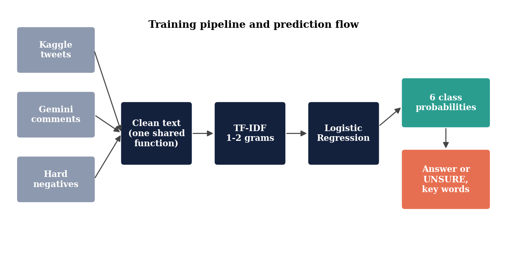

The work followed an iterative, evidence-driven process: build a baseline, audit the data, augment, evaluate independently, analyse failures, and refine the objectives.

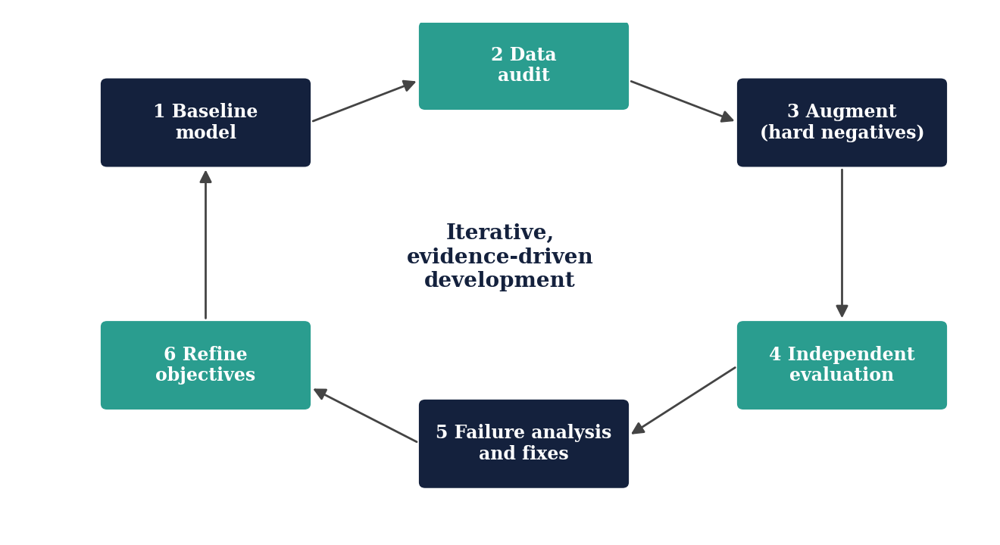

## Data analysis findings

- **Artificial balance:** six classes of about 8,000 tweets each. A model that always answers "bullying" scores 0.858 on bullying against not bullying.
- **Conflicting labels:** 1,675 duplicated texts and 1,639 texts that appear with two different labels, most of them `not_cyberbullying` against `other_cyberbullying` (1,456).
- **Keyword shortcuts:** single words almost decide the class, for example "school" 93% age, "muslim" 96.4% religion, "dumb" 96.7% ethnicity.
- **Tweet length:** a decision tree that sees only the length reaches 0.305 accuracy against 0.167 for random guessing, because the sources differ.
- **Source artefacts and victim stories:** the harmless class is narrow (cooking-show and news tweets), and many age tweets describe past bullying without attacking anyone.

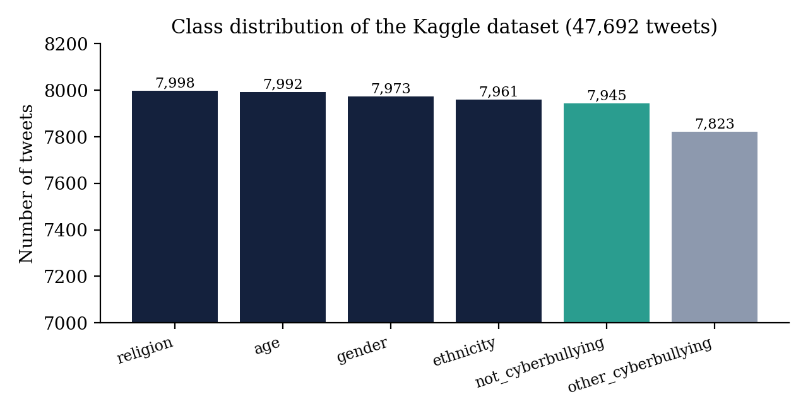

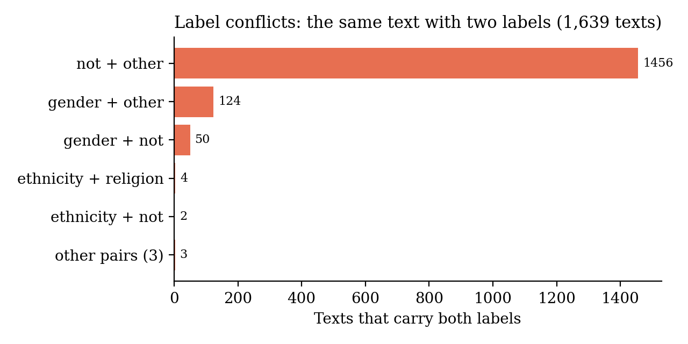

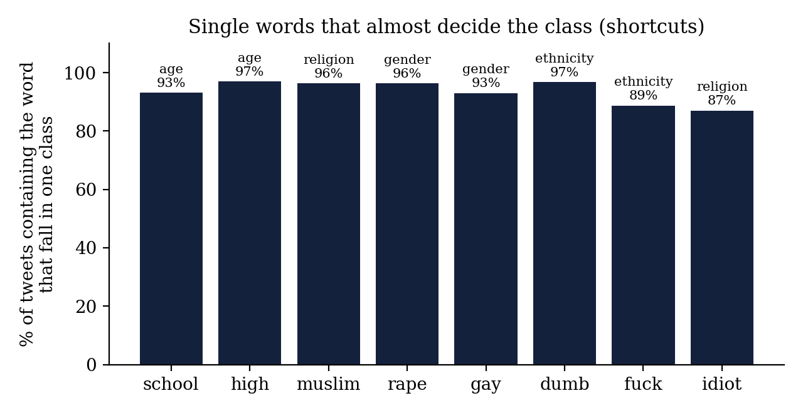

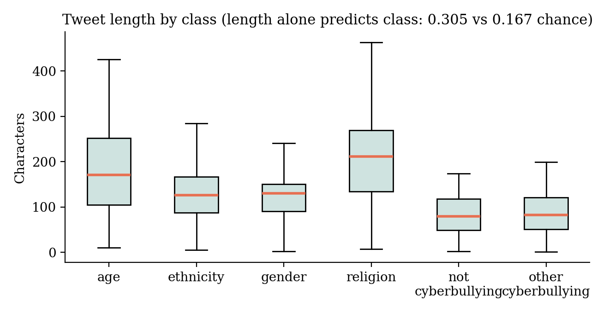

## Results

**Model comparison.** Four linear models are within about one point of each other on the Kaggle test split. Naive Bayes is clearly weaker and the Random Forest slightly weaker and slower. Logistic Regression was chosen for its probabilities, speed and readable weights.

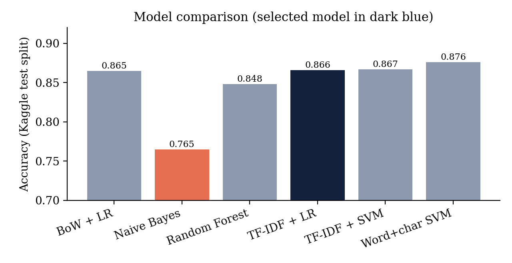

**Cross-dataset evaluation.** High scores appear only when training and test data come from the same source, which is direct evidence of source-specific shortcuts.

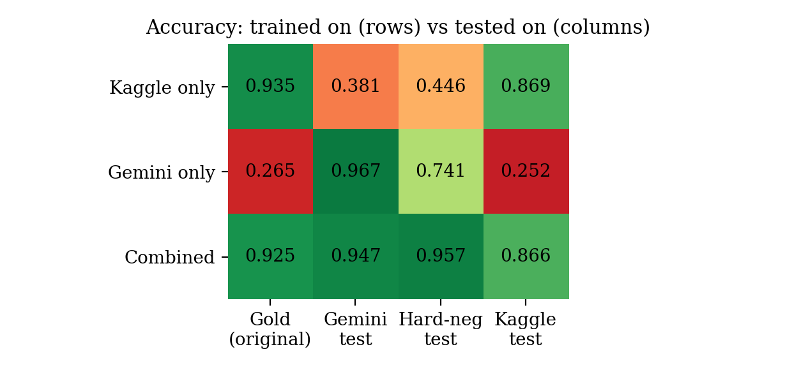

**Confusion matrices.** On the gold set, recall is 0.97 to 1.00 for age, ethnicity, gender and religion but only 0.29 for `not_cyberbullying`: the model over-accuses harmless tweets.

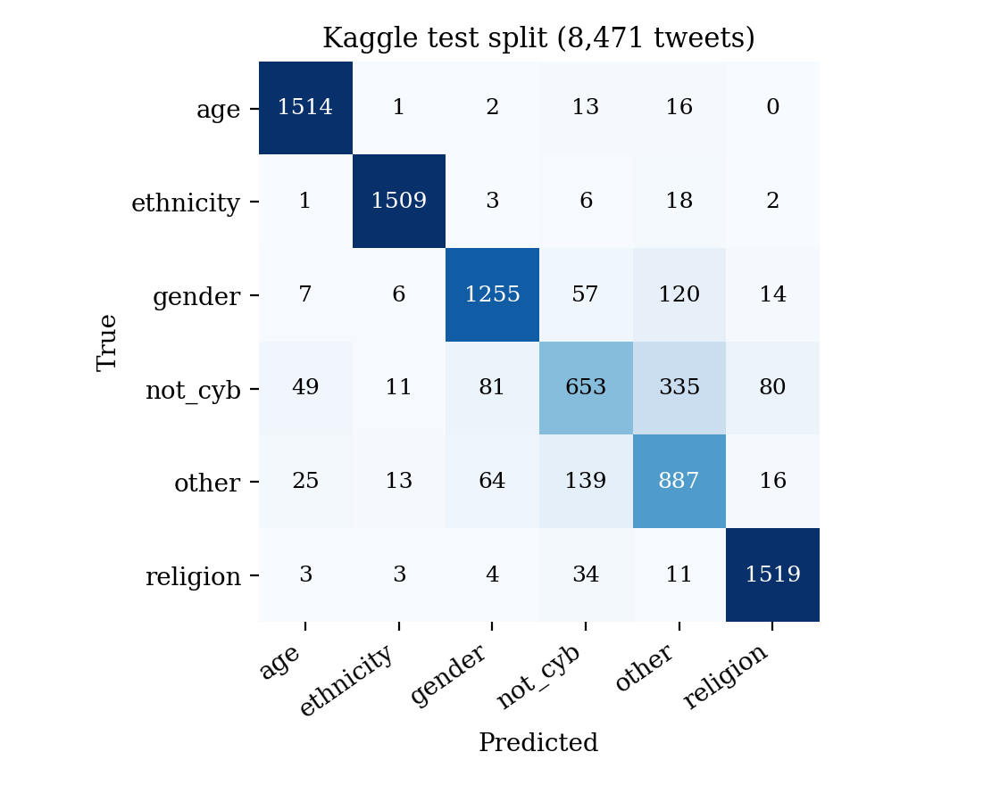

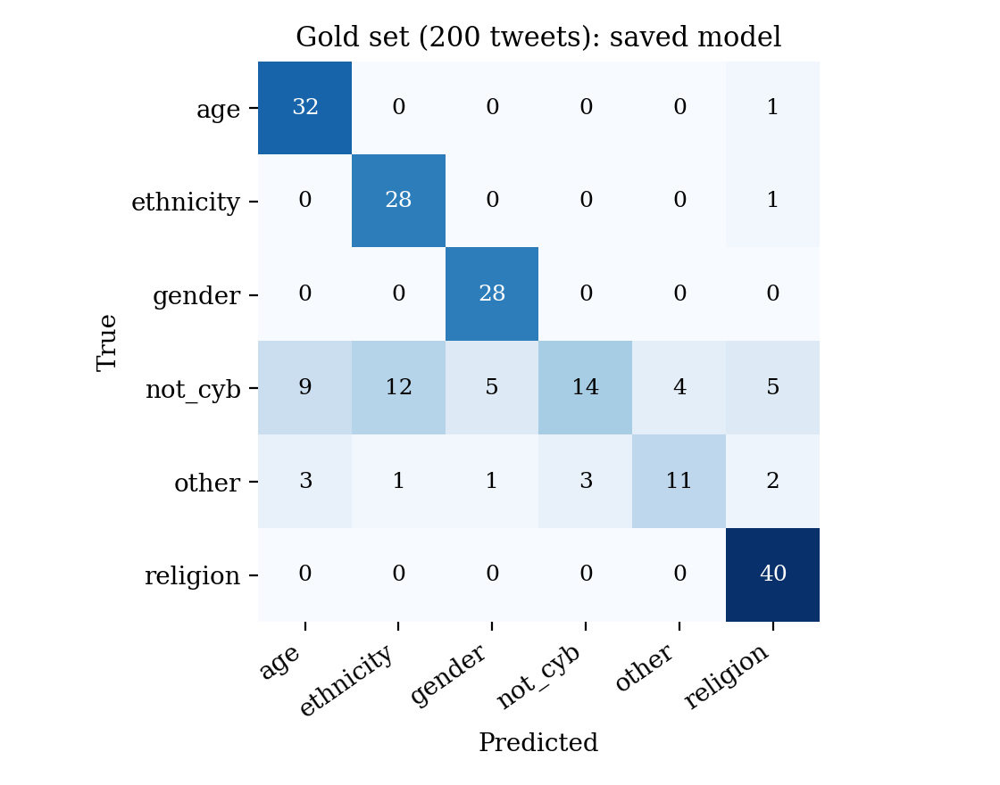

**Weight of the synthetic data.** A large weight fits the generated style but lowers recall for harmless real tweets (0.45 down to 0.20) and raises false alarms (56% up to 71%). A weight of 1 to 3 is a better compromise than the 10 first used.

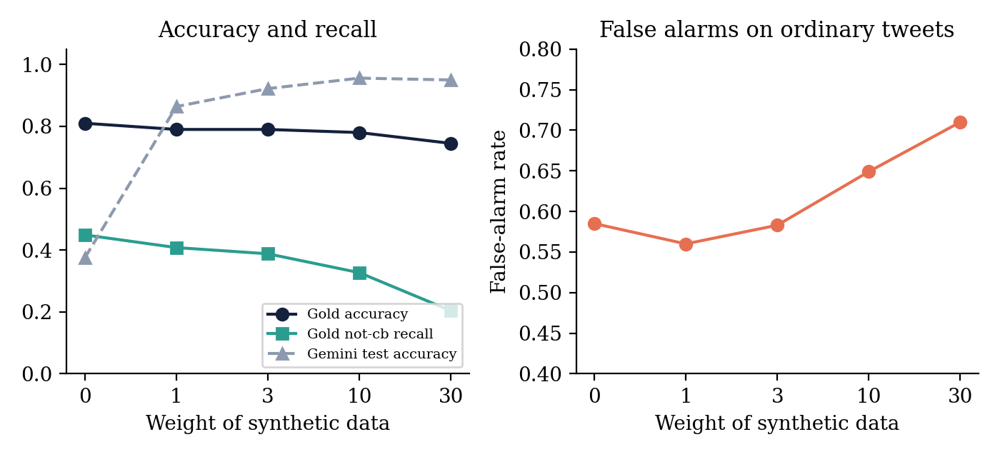

**Feature and model parameters.** Word pairs, minimum document frequency, sub-linear term frequency, stop-word removal and a vocabulary limit move accuracy by one point or less. Only strong regularisation (`C=0.5`) is clearly worse, so the limit comes from the data and labels, not from feature engineering.

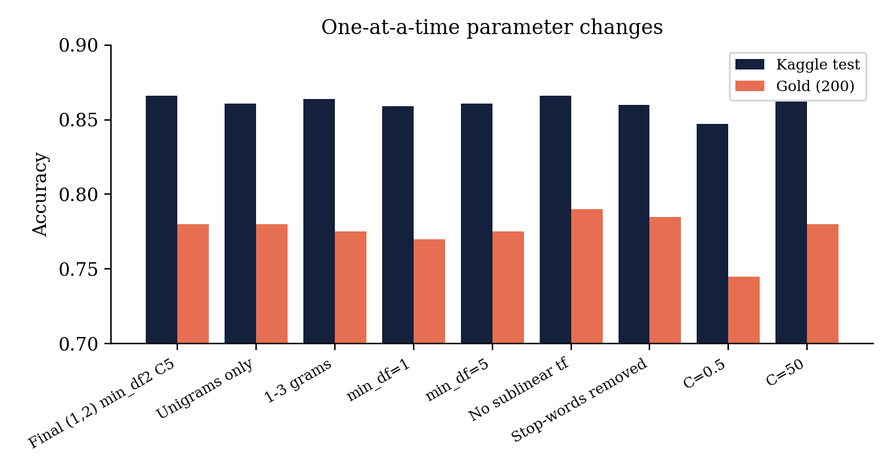

**Adding ordinary tweets.** Adding 5,000 ordinary tweets reduces false alarms from 65% to 24% and costs 0.2 points on the Kaggle test; adding 20,000 gives 9% but lowers Kaggle accuracy to 0.855. The false-alarm test tweets come from the same source as the added tweets, so part of the improvement is a style effect; the gold-set gain (16 to 23 of 49 harmless tweets) is the independent evidence and rests on a small sample.

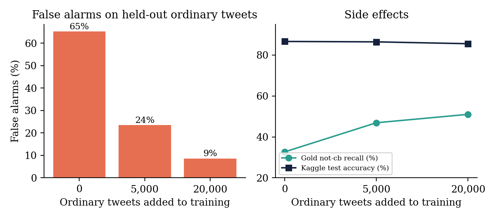

**Length and abstention.** Real comments are usually short, so real-world accuracy is closer to the left of the length curve than the headline figure suggests. The "unsure" option helps, but less on real tweets because the model's wrong answers there are also confident.

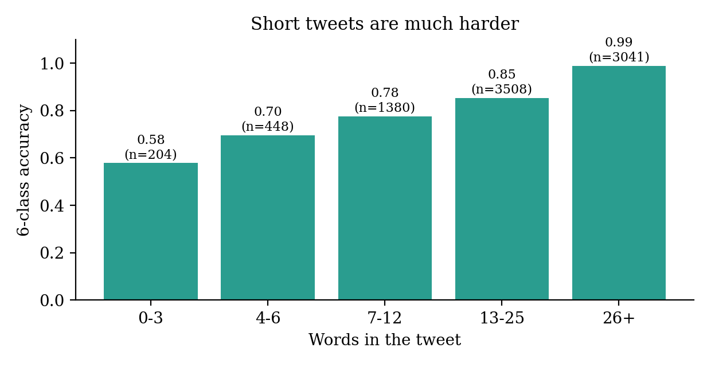

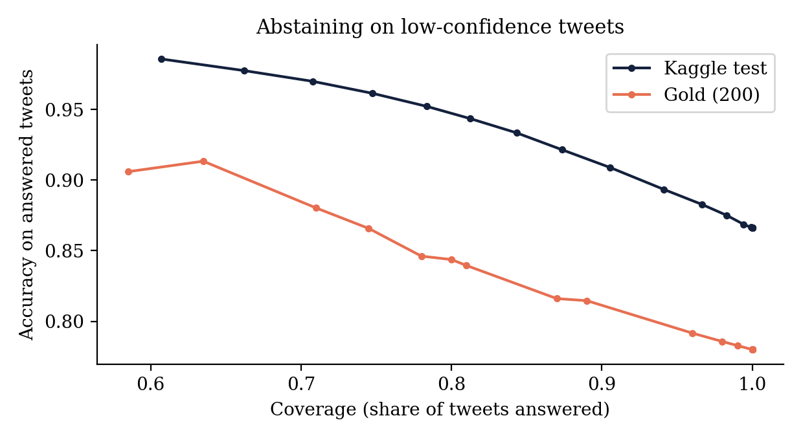

## Evaluation approach and the gold set

The model is not judged by the Kaggle score alone. Four kinds of test data are used because they answer different questions: the Kaggle test split (agreement with the Kaggle labelling), the synthetic and hard-negative test splits (has the model learned the generated style), the 200-tweet hand-labelled gold set `gold_to_label.csv` (real tweets judged by a person), and an external four-class tweet dataset used only to count false alarms on ordinary tweets. Single-text probes check whether identity words alone decide the class.

The first gold set had to be corrected: about half of its tweets were also in the Kaggle training split, so the gold tweets must be removed from every training set before the gold score is read. A second, independent gold set (300 tweets from outside all project files, with a 60-tweet subset for a second annotator and Cohen's kappa) is planned but not yet labelled, so no results from it are reported here. The labelling rules for it:

1. Judge the text only; do not assume who the author is.
2. Ask: is a person or group being attacked, demeaned or harassed? If yes, for what? Labels: age, ethnicity, gender, religion, other_cyberbullying (personal harassment not based on the four identities), not_cyberbullying (no attack: news, advertisements, jokes among friends, slang not aimed at anyone, description of having been bullied, quotation of a slur in order to discuss it, neutral talk about an identity).
3. If an attack hits two identities, choose the more prominent one and note the second.
4. Victim stories ("I was bullied in high school") are `not_cyberbullying`.
5. If undecided, give the best guess and write "unsure" in the notes; do not delete rows.
6. Never change a label after seeing model output; if you do, the set can no longer be used for testing.

## Limitations

- **Label noise:** accuracy on the Kaggle and external data measures agreement with the labelling process, not ground truth.
- **Small gold set:** 200 tweets and one annotator, so the 95% interval is wide (about 0.72 to 0.83).
- **Synthetic data:** recognisable style, labels from one generator, not verified by several people.
- **Model selection on evaluation data:** weights and parameters were compared on the same test sets that are reported; cross-validation was not used.
- **Bag-of-words limits:** negation, sarcasm and context are only partly handled; digits, symbols and emoji are removed and contractions are split.
- **Over-accusation:** colloquial slang and identity words can be flagged regardless of intent, which is a fairness risk for some groups of speakers. Predictions are advisory and every flag should go to human review.
- **Scope:** single-label, English only, short texts.

## Future work

- A larger independent gold set (500 to 1,000 tweets) labelled by two or more annotators, with agreement reported.
- A fine-tuned transformer baseline compared with the TF-IDF model on the independent gold set.
- Cross-validated tuning of `C`, the n-gram range and the dataset weights.
- Real ordinary text as negatives; keeping emoji, obfuscated spellings and contractions.
- A two-stage design (bullying or not, then type) or multi-label classification.
- A fairness audit of false-positive rates by dialect and subgroup, and monitoring for new slang and drift.

## References

1. K. S. Jones, "A statistical interpretation of term specificity and its application in retrieval," _Journal of Documentation_, 28(1), 11-21, 1972.
2. G. Salton and C. Buckley, "Term-weighting approaches in automatic text retrieval," _Information Processing and Management_, 24(5), 513-523, 1988.
3. T. Joachims, "Text categorization with support vector machines: learning with many relevant features," ECML, 1998.
4. T. Davidson, D. Warmsley, M. Macy and I. Weber, "Automated hate speech detection and the problem of offensive language," ICWSM, 2017.
5. J. Devlin, M.-W. Chang, K. Lee and K. Toutanova, "BERT: pre-training of deep bidirectional transformers for language understanding," NAACL-HLT, 2019.
6. R. Geirhos et al., "Shortcut learning in deep neural networks," _Nature Machine Intelligence_, 2, 665-673, 2020.
7. C. Northcutt, L. Jiang and I. Chuang, "Confident learning: estimating uncertainty in dataset labels," _Journal of Artificial Intelligence Research_, 70, 1373-1411, 2021.
8. J. Platt, "Probabilistic outputs for support vector machines and comparisons to regularized likelihood methods," in _Advances in Large Margin Classifiers_, MIT Press, 1999.
9. C. Guo, G. Pleiss, Y. Sun and K. Weinberger, "On calibration of modern neural networks," ICML, 2017.
10. F. Pedregosa et al., "Scikit-learn: machine learning in Python," _Journal of Machine Learning Research_, 12, 2825-2830, 2011.
11. "Cyberbullying Classification" dataset, Kaggle, user andrewmvd: https://www.kaggle.com/datasets/andrewmvd/cyberbullying-classification

## License

[Add a license, for example MIT, and a `LICENSE` file before publishing.]

## Acknowledgement

Guided by [Prof./Dr.] Yashodhara Haribhakta, COEP, M.Tech Data Science
